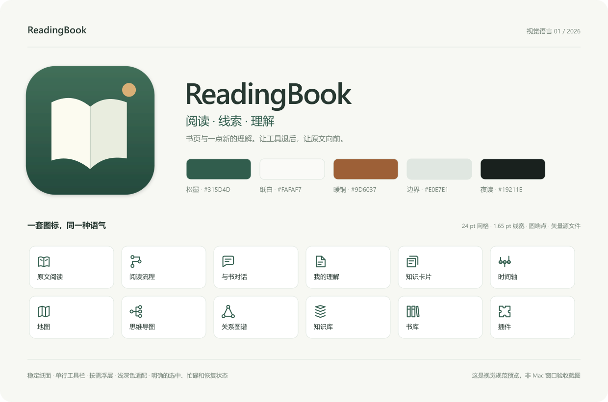

# 0.12.1 导航覆盖层修正（2026-10-17）

用户明确撤回0.12的整列64pt安全带：导航是48×48浮层，底下继续显示完整地图/画布，不能缩窄整页。Workspace现全宽，按钮以实际48pt矩形参与输入排除；顶部停靠在标题之前，底部只避让导图状态与相交的时间卡。书籍、原文、节点和数据保持原路径。此规则替代下文0.12关于64pt列的历史描述。

---

# 0.12 视觉修订（2026-10-17）

沿用霜银/钴蓝。针对Mac反馈，先生成多层伴读和原文索引两张目标，再做交互稿、原生新页。资产：Design/2026-10-ui-study/screens/layers.png、source-index.png；画廊：http://127.0.0.1:4178/design/。

全局左64pt给48pt侧栏图标，拖动上下吸附；顶部岛按内容宽度。伴读是原文解释纸面，索引是对象与出处目录。完整Markdown/LaTeX只折视口，不切源字符串。浮层排除约束背景/节点/端口/连线/滚轮。浏览器28项交互和34状态通过，原生视觉仍待Mac；分别见两个design-qa报告。

---

# ReadingBook 视觉语言 01

## 原生还原 0.11（2026-10-16）

用户已确认整套交互稿用于原生还原，并追加可拖动导航入口。原生界面现统一霜银/钴蓝与44pt命中；书库和所有工作台沿用真实数据，新增导航按钮左上/左下吸附，浮动主壳和领域面板，系统低版本/减少透明度回退继续保留。源代码已实现；[Actions](https://github.com/theincrediblewwz/readingbook/actions/runs/38787646842) 的98项Core检查、双架构编译与资源检查已过；[原生视觉QA](Design/native-frost/design-qa.md)待Mac截图，编译与视觉分别记录；不能沿用浏览器QA作为原生通过证据。对照依据为下列效果稿与交互稿；当前Windows环境无法采集原生实现画面，原生视觉对照结果仍为 blocked，待Mac截图核对。

## 设计工作方式（2026-10-16）

后续 UI 改动遵循：**全页面/控件/状态图文盘点 → 高保真效果稿 → 可点击交互稿 → 按稿还原 → Mac 对照验收**。先形成可评审的视觉与操作依据，再改界面。现状截图、源码结构图、设计效果图和实现截图分别标注来源，不能互相冒充。当前设计资产见 `Design/2026-10-ui-study/`。

用户已选定三套探索中的第 1 版「霜银 · 钴蓝」。阅读效果稿已扩展为地图、导图、笔记、插件和模型设置五张目标图，并按稿实现整个软件的浏览器交互稿：`Design/prototype-frost/`。本地入口 http://127.0.0.1:4178/，整套效果图 http://127.0.0.1:4178/design/。其余界面复用同一组件、密度、命中区和浮层规则，覆盖书库、译注对照、对话、流程、知识、卡片、总览、关系图与回收站。交互稿阶段没有改写原生 SwiftUI；现已进入上文 0.11 原生还原阶段，下面松墨规范保留为历史生产基线，不再代表新交互稿的强调色。浏览器检查见 `Design/prototype-frost/design-qa.md`；Mac 原生材质与实际数据功能仍待后续还原和验收。

0.10延续品牌与系统玻璃：正文是主画面，伴读按需在右边展开；宽窗内联、窄窗浮动，40pt命中区与单个阅读工具岛。原文译注成对排列在同一滚动容器，窄窗堆叠。总览通过一个菜单选章节、类型、年代或共现，图形可回来源。关联词支持点击和键盘，同时保留原生拖选。原书、AI译注、出处和用户Markdown用明确标签区分。

方向：**阅读、线索、理解**。书页是稳定的底，工具在需要时出现；松墨色负责导航与操作，暖铜色代表一处值得停留的新线索。此规范用于后续版本，不随每本书或 AI 自定义类型改变整套产品样式。

这是规范预览，不是 Mac 窗口验收截图。

当前批次为 **0.9.0 / build 9，已通过 [Actions 构建](https://github.com/theincrediblewwz/readingbook/actions/runs/38680040475)，待 Mac 验收**；源码 `6345ac7fd9858325c810ad889c58c80e5ad05d8e`。62 项核心测试、双架构编译、签名及资源自检通过，无编译警告。下面的规则描述目标与源码约定；编译和静态检查不能证明本批窗口、焦点、原生手势或视觉性能已经通过。历史 [0.8 Actions](https://github.com/theincrediblewwz/readingbook/actions/runs/38675653923) 的 59 项检查、编译及资源验证仅适用于旧包。

## 标记与图标

- 独立 App 标记：打开的书页与一枚暖色圆点。保留通透留白、小尺寸轮廓和 16–1024 px 原生图标尺寸，禁止往图标塞书名、模型标记或版本号。
- 自有 12 枚导航/知识组件图标采用 24 pt 网格、1.65 pt 基准线宽、圆端点。原文、流程、对话、理解、卡片、时间轴、地图、导图、关系、知识库、书库、插件共用这一套。
- 关闭、播放、搜索、缩放等平台通用动作使用 SF Symbols；AI 自定义类型可继续选择合适的系统符号，不改变组件导航的品牌形态。
- 唯一几何来源：`Sources/ReadingBook/Resources/Brand/symbols.json`。`BrandDesign.swift` 绘制原生界面图标，`scripts/make-icon.swift` 从同一来源生成 `.icns`；`Design/generate-preview.mjs` 生成可检查的 SVG 规范和 App 图标。

## 色彩与排版

| 角色 | 浅色 | 深色 | 用途 |
| --- | --- | --- | --- |
| 墨色 | `#273831` | `#E1E9E2` | 主要文字 |
| 松墨 | `#315D4D` | `#A1CAB4` | 操作、选中、原文链接 |
| 纸白 | `#FAFAF7` | `#19211E` | 阅读背景 |
| 表面 | `#FFFFFF` | `#232D28` | 笔记、卡片、弹层内容 |
| 暖铜 | `#9D6037` | `#D4A57A` | 疑点、细微品牌强调 |
| 边界 | `#E0E7E1` | `#3A4941` | 轻分隔与边框 |

界面用系统字体，导航 14 pt、常用控件 13–15 pt、辅助说明 11–12 pt；正文保留 16–17 pt、宽松行距。章节与理解标题可用系统衬线字体。公式由离线 KaTeX 排版，代码用等宽字体；不为了装饰缩小正文或淡化重要提示。

## 空间与状态

- 窗口工具栏只留普通书名、明确命名的 AI 服务/精读任务与更多操作。翻页、搜索、批注、缩放和目录组成一块浮动阅读工具，不再在窗口和内容区重复摆放同一操作；正文保持稳定纸面。
- 搜索、目录、批注、模型配置按需展开。收起侧栏必须把空间还给原文。PDF 自带的页边空白属于原文件，不用界面裁切伪装空间改善。
- 内容卡片半径 14 pt；浮动工具与面板约 20–24 pt。常用浮动按钮 40 pt 命中、导航行 48 pt；组内间距 8 pt、面板留白 16 pt，集中由 `ReadingLayout` 定义。侧栏和列表的文字、图标、行内空白共享整行命中。浮层用细光边与柔和阴影，与稳定纸面区分，不逐个给所有图节点叠玻璃。
- Liquid Glass 用于导航、工具和浮层，长文使用稳定纸面；低系统版本使用系统材质回退。
- 选中状态同时使用位置标记、字重及颜色；工具保留名称或帮助说明。忙碌时禁用会冲突的写入；失败保留草稿，删除必须能看清范围，恢复入口可见。
- 系统浅深色、800×600 最小窗口、工具溢出、键盘与触控板行为仍须 Mac 验收；源文件和规范图片不代替实际运行证据。

## 0.9 尺寸、位置与选择器（已编译、待 Mac 验收）

- 借鉴 [Steam Big Picture](https://help.steampowered.com/en/faqs/view/3725-76D3-3F31-FB63) 的清晰层次、适中留白和易识别操作；保留桌面键鼠阅读。具体尺寸为本项目选择，参考 Apple 的[按钮一致性](https://developer.apple.com/design/human-interface-guidelines/buttons)与[布局](https://developer.apple.com/design/human-interface-guidelines/layout)原则。
- 阅读工具维持单一玻璃 dock。空间充足时显示“批注”，窄窗合并到阅读选项，翻页与查找仍直接可达；笔记分段器、知识库分区与搜索提供窄窗替代布局。设置、插件和聊天使用同一留白及操作尺度。
- 时间卡默认在下方中央；只拖标题/六点把手，松手吸附四角或下方中央，位置跨重启记忆。滑轴、事件点、按钮和滚动详情不移动面板。Esc、失焦、切书或窗口尺寸变化取消拖动；右上停靠避开地图控件，窄窗两个上角仍能区分。详情沿当前停靠边展开，地图定位使用实际面板留下的空间。
- 导图与关系图节点浏览器在右边，收起入口也在右边，左侧只保留状态。相机显示全部、定位及缩放锚点避开右栏；开关面板保留缩放和可见世界中心，面板滚动与相机工具不穿透到画布。
- 侧栏“添加组件”只展示未添加且非永久组件，每项配图标；添加后消失，移除后恢复。禁用插件的已保存入口不重复添加，需在插件页启用。知识库、OCR、快捷服务与高亮颜色的选择器分离或隐藏挤压标签，同时保留辅助功能名称。

## 0.8 浮动工具与连续画布（沿用交互基础）

- macOS 26 使用系统交互玻璃及玻璃容器/稳定标识，低版本使用材质回退；减少透明度时改用不透明表面。边缘高光、柔和阴影、悬停与按压反馈属于同一套工具样式。[Apple 自定义玻璃说明](https://developer.apple.com/documentation/swiftui/applying-liquid-glass-to-custom-views)为实现依据。
- 动效只用于导航选中、工具状态和浮层展开/收起；尊重减少动态效果。节点拖动、相机坐标和时间端点持续更新时保留即时反馈，不插入位置缓动。
- 思维导图/关系图谱的背景是当前视口，世界坐标经相机投影；画布没有固定纸张边缘。浮动列表与相机工具各自接收输入，列表自身滚动不带动画布。节点单击在列表下预览已保存内容，双击打开；第一击不收缩列表或把该行移到别处。
- 地图填满视口，时间轴是单一悬浮卡内的一根双端点轴。事件详情在轴下展开并可收起；拖动筛选期间详情区占高稳定，筛掉当前事件时提示原因。窄窗限制详情高度、内部滚动，地图仍保留可操作区域。

## 空间基础（0.5 起沿用）

- 普通工作页使用约 48 pt 的单行栏、17–18 pt 标题；原文、图谱与时空页使用浮动工具；去掉重复的执行按钮、闲置状态栏和占高的大统计卡。正文仍保持 16–17 pt，压缩的是工具与留白。
- 地图只保留一根时间轴和两个范围端点，事件点共用这根轴。精确年份、时间待考选项与可搜索事件清单按需打开，不常驻两根滑杆和一排大卡片。普通标记保持紧凑，选中显示名称，时间与地点在轴下详情展开；重新进入页面保留当前时间窗。
- 对象详情默认收起。图谱使用局部详情弹层，选择和操作节点不自动挤窄画布；其他页面按适用宽度提供显式详情。收起详情保留选择，卡片仍可直接点击查看内容。
- 笔记用可搜索弹层选择/新建文档，标题直接修改后保存，编辑/预览及管理留在一行。知识库按笔记/分析/要素切换，搜索跨三类，长分析展开再读。
- 插件、类型、读书法说明和模型高级参数按需展开。流程折叠细节时仍露异常/待核对数量、当前执行状态，不通过隐藏警告制造整洁。
- 较小弹窗内滚动内容，保存/取消固定可达；长名称、端点重合、同年/负年份、键盘调整与缩放均列入 Mac 验收。

自定义时间控件保留原生 Slider 的[辅助功能表示](https://developer.apple.com/documentation/swiftui/view/accessibilityrepresentation(representation:))，并支持[焦点键盘事件](https://developer.apple.com/documentation/swiftui/input-events/)；它们仍需在 Mac 上实际检查。

## 0.6 就地操作（已编译，待 Mac 验收）

- 图谱不常驻“打开/写理解/连线”按钮或连接表单。单击选择、拖卡移动、双击文档打开；边缘圆点支持点击/拖动连接，右键可“从这里连线”或选择目标，Esc/空白取消。端口与卡片移动分流，滚动后保持同一画布坐标；同文档的不同节点按实际 node ID 区分。
- 连线名称双击原位编辑，Enter 保存、Esc 取消；右键只移除指定 edge。同向/反向边可区分，失败保留待改名称，忙碌/切书不能串图。键盘和辅助动作保留，不只依赖精确拖动。
- 图谱来源/关系通过本地右键或相应对象双击弹层查看，不开挤画布的右栏。节点/边操作与打开文档范围分开，移除节点保留真实正文。
- PDF 搜索保留独立按钮/⌘F，区域框选只在高亮菜单；侧栏展开服务栏与工具栏入口保留，去掉重复设置齿轮和更多菜单中的 AI 配置项，窗口更多菜单/侧栏导入导出菜单保留。笔记标题直接改后保存，新建留在选择器。
- 摘录只用一个 sheet：标题固定，只读 Markdown 连续选择与可折叠即时预览同页，底部一次“保存摘记”与取消。完整/合并/语义摘录共用结构，公式/图片与源文差异、问题/证据及回收恢复保留；核验未完成禁存旧预览，失败保留标题和选区。
- 人工验收重点为 800×600、520×440 摘录弹窗、浅深色、端口不移动卡片、滚动后落点、连接时不打开文档、Esc/Enter/焦点、取消/失败与多边精确删改。0.6 已通过 Actions 编译和包内资源检查，源码、规范和编译结果不代表 Mac 视觉与交互已通过。

## 0.7 状态保护与动作稳定（已编译、待 Mac 验收）

- 服务配置切换/新建先处理未保存输入：保存并继续、放弃更改并继续、取消。确认前不切换地址、模型、预算或密钥；验证失败保留输入，错误贴近表单。侧栏、工具栏和独立设置共享这项行为，不能同时弹两份确认。未保存模型草稿只在本次进程内保留。
- OCR 将范围错误与“没有可识别页”分开；显示本轮识别数、跳过数、原因和预算外剩余页，细页码按需展开。错误放在相应范围/服务附近，长说明和错误可滚动；约 640×660 的表单底部仍能取消、设置和确认。
- 插件页、侧栏和渲染器使用同一组件注册来源，地图/时间轴归为“时间与地图”。已有/常驻组件显示打开；添加成功保留当前页并给出就地反馈，显式打开才导航。注册接口随源码编译，声明包配置受控能力，不提供任意代码热加载。
- 合并入口的移除范围与显示范围一致，菜单说明将同时移除多少旧重复入口，不能删除后又露出隐藏别名。原知识保留，可重新添加入口；不同类型筛选的卡片集合保持独立。
- 卡片直接在当前详情编辑，必填/已填内容优先，空可选字段折叠。保存、取消及错误留在详情内；切换对象或关闭时保护草稿，不能为了减少弹窗而静默丢输入。正文与来源仍完整可读，不挤进只有一行的摘要。
- 回答平时保留紧凑保存菜单，需要合并时才出现多选框与合并操作；取消多选回到阅读。来源、公式语义差异和保存前核对继续可达；同一保存错误只在当前操作附近呈现一次。
- 图谱节点与端口用原生事件捕获窗口位移，拖出卡片后仍完成当前手势；预览使用绝对位置并保留到保存回调，失败恢复可靠数据。只在拖动开始发布选择，网格使用静态 tile，保存提示保留稳定高度；不通过整页重排、底栏伸缩或选择变化让卡片在拖动中跳位。
- 时间轴仍是一条轴和两个端点。拖动期间的 bounds/宽度使用一致快照；缩放、范围刷新、切书或离页时安全结束/取消旧手势，新书不接收旧坐标。负年份、同年端点、键盘与辅助功能继续验收，源码修复不等于 Mac 手势通过。
- 流程只增加必要状态：当前动作、成功/失败、来源、重试与显式重置可见，完整输入/输出和工具记录按需展开。已完成步骤续跑不重放，知识抽取须有真实变化凭据或无变化理由，本地引文核验不包装成理解正确。

本批按配置→Max→PDF/批注→OCR→方法与步骤→卡片/时空/插件→公式与摘录→图谱拖动→删除恢复→重启导出集中验收；所有 Mac 勾选仍留空。尚无本批真实 AI 请求结果，也不声称扩展能力已经等同 DSH。
