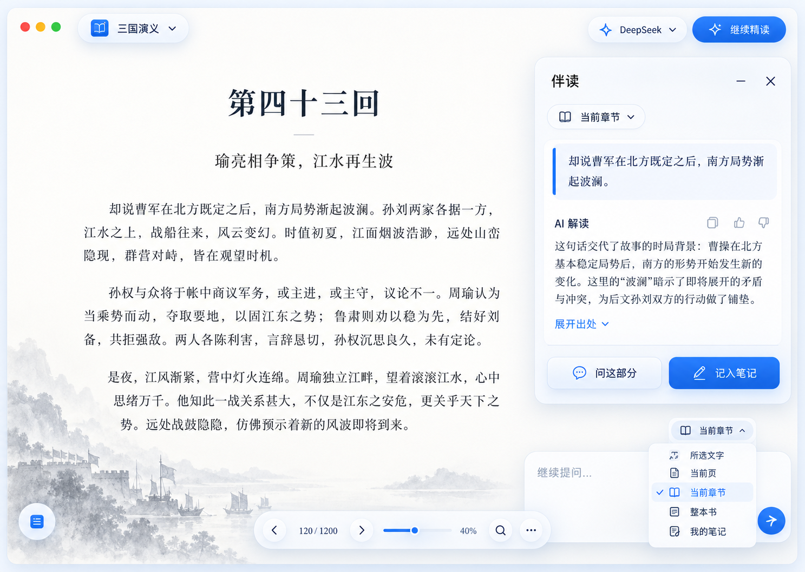

# ReadingBook：以读者为中心的下一版

2026-10-23。依据用户这次 10 项反馈、两张 Mac 实机截图、当前 ReadingBook 和最新 Lumen 源码。用户已确认：按方案先简化阅读界面、范围选择与上下文，再开放写入和时空联动。下文保留评审时的目标契约；实际实现与验证状态以文末记录、源码及 Actions 为准，不把设计图当成 App 截图。

第一批修复已单独编译为 0.13.2/build16：源码 `d064ef8`，Actions 39933874518，165 项 Core 与双架构/资源检查通过。它不包含下文三张新布局、范围选择、28 个新工具、人物轨迹或图谱微动；这些等待评审后实施。

## 先把产品收回来

主导航保留：原文、读书方法、与书对话、我的笔记；AI 按书选用时间与地图、思维导图、关系图谱、实体卡片和知识库。插件、模型、回收站放在管理入口。数学核查、原文索引、思考卡退出产品入口与新 AI 任务；旧文件、笔记、回执和记录保留，兼容读取，不做破坏迁移。

伴读值得保留，但定位为原文旁可关闭、可收起的解释助手，不再用一个“增强当前片段”的开发空态代表核心体验。独立“已有伴读”页面只整理真正生成过的内容，不列出几百个空页面。

保留霜银/钴蓝、悬浮导航与工具、Liquid Glass。正文优先，浮层不占整列。按钮命中 44pt，标题/文字/空白区域属于同一整行操作。所有浮窗右上有明确关闭；可收起与关闭分开，弹出设置不提供无意义的折叠按钮。

### 三张关键画面

1. **阅读与提问范围**：原文占主体，右侧伴读可关，范围用自然语言显示。选区、当前页、当前章节、整本书、我的笔记由用户选择。图内文字、历史叙述和页码是排版示意，不是原书引文或已验证史实；实现时页码与进度来自同一真实数据。
2. **读书方法**：展示这本书的类型、AI 推荐怎样读、会生成哪些实际线索，一条任务状态和开始/暂停。逐段回执、重试、工具日志留在按需打开的“处理详情”，默认不出现计数仪表盘。
3. **人物与时空**：选中人物，唯一时间轴带范围端点与当前时间指针。地图、人物卡、事件列表共用同一个实体 ID 和时间快照，滚时间就能看不同时期的活动。

设计图不是原生截图，也不是已经完成的交互稿。选定布局后再做可点击、拖动、收起、展开及宽窄窗稿，之后还原到 Mac。




## 阅读范围到底传什么

当前事实：伴读增强读取 selectedUnit 全文，缺逐段回执时先补回执；它既不是实时视口，也不能据页/行标签判断一定只发送那几行。对话虽然显示当前定位，却仍对全书做有界检索，没有用户可选的范围。两者都需要明确的范围契约。

| 读者选择 | 实际给 AI 的内容 | 范围变化与不足 |
| --- | --- | --- |
| 所选文字 | 用户确认的完整选区、精确出处；另给少量前后文且标清边界 | 发问时冻结选区；跨页/公式无法精确定位时说明，不能悄悄换成整页 |
| 当前页 | 原 PDF 当前页所有已提取/OCR 的文字、阅读顺序与必要前后衔接 | 没有可靠文字则先提示识别；图像需用户选择视觉服务，不能声称看过未发送图像 |
| 当前章节 | 当前章节目录与可用内容，按预算分段读取；短章节可完整发送 | 超预算不静默裁剪为第一段；说明已读/未读范围并可继续取文 |
| 整本书 | 全书目录、已有全书/章级分析的覆盖范围；先检索，再读相关原文 | 不把整本书一次塞入上下文，也不把局部命中说成通读全书。综合问题需跨章节读取并披露不足 |
| 我的笔记 | 用户选定笔记的目录；按需检索与读取真实 Markdown | 原书、AI 分析、用户笔记分别标明来源；不默认扫描无关全文 |

伴读默认“当前页”，用户可改“当前章节”；有选区时出现“解释所选文字”建议，不自动篡改已锁定的问答范围。范围在发问时生成不可变快照，之后翻页不会改变正在回答的问题。PDF 视口跨两页时显示真实页集合，不硬说成单页。

已有伴读目录默认只列有释义/译文/对读内容的页或章节，附真实条数；空章节不列。正在阅读但没有内容时仅在原文旁显示简洁空态，可主动请求解释。筛选后无结果显示一次空态，不为每页重复空卡片。

## 读书方法按书型组合

书型可多选，不将历史、战争和小说互斥。AI 预读提出类型、方法、实体类型与组件；用户可改，也可以定义新的书型/方法。方法仍绑定实际执行能力，不只是建议文字。

| 书型 | 默认理解重点 | 适用产物与组件 |
| --- | --- | --- |
| 历史 | 年代、事件、人物、制度、不同来源与因果 | 事件与实体、时间地图、关系图、章节笔记 |
| 战争 | 战役阶段、参战者、地点、行动与前因后果 | 战役—阶段结构、参与记录、地图足迹、有来源的移动段 |
| 小说 | 叙事次序、人物变化、线索与冲突 | 人物、事件、关系变化、章节导图；默认避免超出当前阅读进度的剧透 |
| 论述/研究 | 主张、材料、概念、反例与局限 | 概念/论证实体、依赖关系、引文笔记 |
| 教材 | 定义、条件、例子、方法与先修关系 | 概念/方法图、问题与笔记；不预置专用数学验算插件 |

《三国演义》用“历史 + 战争 + 小说”：按作品原文建立人物与别名、战役、阶段、地点、参与角色、时态关系；小说叙述与史料事实分开标识，原文没写明的日期、人物位置或路线不猜造。

后台继续完成原文清单 → 逐段简短复述与精确锚点校验 → 所选读法动作 → 实际知识产物 → 检查点。读者默认只看“准备读什么、正在读哪里、得到什么”；需要 OCR 或配置帮助时才出现能操作的提示。处理覆盖不等于理解绝无遗漏。

## 同一个实体怎样贯穿时空

已有基础：实体、事件、地点、关系有稳定 ID，组件可共享。缺口：实体只有静态坐标；事件只关联一组参与者和地点；关系无有效期。事件有三个人、两个地点，不能据此推出三个人都去过两个地点。

建议新增可选结构，旧档仍可加载：

| 数据 | 关键字段与用途 |
| --- | --- |
| TypedObject / 实体注册 | 所有可关联对象有稳定 objectID、typeID、版本、字段值和出处；人物、地点、事件、组织、概念都按类型定义。AI 可复用默认类型或声明字段化新类型；时空、参与和关系是对象能力，不是组件私有副本 |
| BookProfile | 可组合书型、适用实体类型、读法与组件、时间体系、剧透边界 |
| TemporalExtent | 原文时间表述、纪年/历法、最早/最晚、精度、未知/约数/争议；小说另用叙事顺序 |
| EntityPresence / Participation | entityID、placeID、eventID 可选、时间/叙事顺序、角色、anchorIDs、明示/推断/未知，记录“这个人物此时此地做什么” |
| Event 扩展 | kind、parentEventID、阶段顺序，使战役与阶段能组织起来 |
| Relation 扩展 | 有效时间、身份/阵营变化及来源，不把一生关系固定为一种 |
| Place 定位 | 历史地名、别名、候选位置/近似区域、定位来源与争议；地名身份和坐标解释分开 |
| MovementSegment | 只有存在路线依据时才记录出发/到达、路线几何和来源；与两个出现点的连接示意分开 |

读取层先把现有 KnowledgeEntity / KnowledgeEvent 适配为同一对象接口，保留原 ID 和旧引用；后续可选字段逐步补齐，不为“统一”搬移原书或重写笔记。地图、时间轴、卡片、导图和查询只保存对象引用与各自展示配置，同一个人物不会因为出现在五个组件中被复制成五份。

交互：选人物 → 查询该人物的出现记录和事件 → 拖当前时间 → 人物卡显示此时身份/关系/行动，地图只显示该时点相关足迹。单轴两端点过滤范围，中间指针表示当前时间，不再复制两根时间轴。未知年份可按章节/叙事先后浏览；时间精度不足时不伪造一天。

轨迹默认是“有出处的先后出现”，虚线只表达次序，不代表真实行军路线；不插值伪造此人中间每一天的位置。所有视图返回同一出处，可从人物卡、事件、地图或关系回原书。

## 交给你审核的 AI 接口

以下是已获批准的 **28 个目标工具**。实现按范围和宿主权限加载能力组；普通提问不提供写提案 schema。工具实际注册与结果必须通过后续源码和构建验证。

| 组 | 工具 | 主要输入 → 输出 |
| --- | --- | --- |
| 发现 | capabilities_list | 阶段/任务 → 当前实际安装能力、权限、参数与结果上限 |
| 发现 | book_schema_get | bookID → 类型/字段、关系词汇、书型、可执行读法与 renderer |
| 原文 | source_outline | 章节/游标 → 目录、页范围、可靠文字/识别缺口，非全文 |
| 原文 | source_search | 范围、1–8 关键词、any/all、游标 → 命中位置、短片段、总数/部分结果声明 |
| 原文 | source_read | 单元/页/章节、offset/limit、expectedHash → 精确正文、定位、hash、nextCursor/是否完整 |
| 原文 | reading_coverage_get | 范围 → 实际处理覆盖与缺口；此工具不增加覆盖 |
| 实体 | objects_search | 类型/别名/关键词/时间 → 统一实体/事件 ID 与短摘要 |
| 实体 | object_get | objectID、字段集合 → 对象属性、来源、版本；不自动读挂载全文 |
| 实体 | relations_list | objectID/关系类型/时间/游标 → 有效关系、对象 ID、出处 |
| 时空 | events_query | 人物/地点/时间/战役阶段 → 事件与参与角色、来源、分页 |
| 时空 | entity_history_get | entityID、时间/章节范围 → 出现记录、足迹、关系变化、未知与争议 |
| 笔记 | documents_list | 当前书/用户选定文档范围、游标 → 文档目录、来源类型、hash，正文未读取 |
| 笔记 | documents_search | 范围、多关键词、游标 → documentID/offset/片段，读取失败明确标记 |
| 笔记 | document_read | documentID、offset/limit、expectedHash → Markdown 原串、总长度、nextOffset |
| 会话 | conversation_search | 当前会话、关键词、角色、游标 → 原消息 ID、命中位置与状态 |
| 会话 | conversation_read | 当前会话、消息 ID/offset → 完整或分段原消息、角色、来源定位 |
| 当前界面 | workspace_context_get | 请求字段 → 当前书/视图/页/选区/对象/时间窗/相机快照；不含未读正文 |
| 当前界面 | visible_objects_list | 视图/游标 → 真实可见对象 ID、遮挡/截取信息；“可见”不等于已读取 |
| 派生内容 | knowledge_changes_propose | 基准版本、批次 → 类型/实体/事件/参与记录/时态关系/阅读层的具体变更与来源预览 |
| 导图 | graph_changes_propose | 图 ID、节点/文档 ID、操作批次 → 建节点、挂载/解绑已有文档、连接/改名/移除布局边、移动节点或整组、分组结果预览 |
| 笔记 | document_changes_propose | 新文档内容/现有文档 diff、expectedHash、挂载目标 → 新建/追加提案与真实 Markdown 变更预览 |
| 读法 | book_scheme_propose | 书型组合、类型/方法/组件与理由 → 沿用方案预览/采纳；模型不能自行点确认 |
| 视图 | view_select | 真实 rendererID → 打开该组件；未知组件明确失败 |
| 视图 | view_focus | objectID/anchorID/documentID → 聚焦对象或出处、返回之前视图的句柄 |
| 视图 | view_set_time_window | 时间体系、起止/当前时间 → 地图/人物卡/关系的统一时间快照 |
| 视图 | map_fit_objects | 对象 ID/有证据足迹/留白 → 临时地图视野；无位置不假称已定位 |
| 视图 | graph_focus | 图与节点 ID、范围 → 临时相机/选中状态；不改节点保存坐标 |
| 视图 | panel_present | 已注册面板、显示/收起/关闭 → 实际状态；用户正在拖动时延迟或拒绝抢焦点 |

图的**布局边**与“某人参与战役/支持某人”这样的**知识关系**分开；前者不自动当事实，后者必须有证据。节点引用文档，不能复制一份正文后失去同步。

导图操作以画布物理 nodeID 为目标，同一文档可出现多个节点，不能误把它们合并。移动整组时先解析实际递归子节点，保存开始布局的版本与坐标，一批提交、一次撤销；不在 AI 等待或用户拖动途中覆盖临时位置。新建文档与挂载节点可进入同一宿主变更批次，失败不留孤立文档或空挂载。

### 权限与提交

- 普通聊天默认只读；用户说“把这些回答整理成导图/笔记”可授权这次具体新增任务，之后的工具步骤不用每一跳重复确认。自动读书已获授权的派生知识继续自动落盘，保留来源与逐段门禁。
- 修改已有用户正文必须先给具体 diff，再确认本次修改；AI 不能把一段历史消息或摘要当作当前授权。第一阶段不开放永久删除、覆盖原书/OCR、任意文件路径、Shell、插件安装或外部网络。
- 宿主生成 bookID/sourceHash/revision、会话与允许资源、grantRevision、operationID。AI 只提交业务动作；落盘前重新核对授权、版本和文档 hash，不在等模型时锁住编辑器。
- 同一 operationID + 相同内容重试复用回执；相同 ID 不同内容拒绝。用户已移除产物后不静默重放。返回真实对象/文档 ID，不用“已创建”的自然语言当凭据。
- 文档、节点挂载、关联与回执原子提交。撤销只撤本次产物，核对后续编辑；有冲突保留用户内容并展示差异，不能整书回滚覆盖。
- 所有结果区分 success/partial/needs_confirmation/conflict/unsupported。分页必须前进，明确未读范围和失败原因；工具返回文本不构成系统指令。

示例业务批次（拟定格式，不是现有可调用 API）：

```json
{
  "operationID": "host-issued-id",
  "baseRevision": "host-issued-revision",
  "operations": [
    {"kind": "create_node", "clientID": "battle-note", "title": "本场战役的前因后果"},
    {"kind": "create_document", "clientID": "note", "title": "战役笔记", "markdown": "经用户要求整理的正文", "sourceAnchorIDs": ["host-validated-anchor"]},
    {"kind": "attach_document", "nodeRef": "battle-note", "documentRef": "note"},
    {"kind": "connect_nodes", "fromNodeID": "existing-node", "toNodeRef": "battle-note", "label": "延伸阅读"}
  ]
}
```

人物、战役和出现记录由 knowledge_changes_propose 另一个有证据批次写入；图里展示这些同一对象。宿主解析请求内别名，回执返回真实 ID。

## 上下文怎样不越聊越胖

最新 Lumen 本地/远端基线为 `cee9e26c610fb3b17f42e273669ed0d6ffa1068d`（已核远端 master）。早先“语义记忆尚未启用”的文档是旧时点；后续 `fba482f` 已实际接入 prepareMemory，默认 auto。不能把旧讨论当最新实现。

ReadingBook 现状也要说准确：answer 当前不接收历史消息，是一次只读有界检索，并不存在把工具全文跨所有轮次永久重发的问题；真正缺口是连续对话缺上下文，以及每问预读最多 20 万字笔记再筛片段的无关 I/O。

建议采用最新 Lumen 的这些机制，并接入本项目的原文/权限边界：

1. **小快照**：当前书、问题范围、选中对象、视图/时间、少量目录；节点只传身份、简介、挂载文档目录，不自动传正文。
2. **按需检索与重读**：工具找关键词 → 具体文档/原文位置 → 分页读取。工具全文只在当前回答需要的窗口内保留，跨轮保存出处/hash/回执。
3. **短期历史**：保留近轮原问题和回答；原始聊天完整留盘。当前问题不静默截断，精确引用优先回读原消息或原书。
4. **派生滚动记忆**：长会话才按预算压缩旧前缀，保存源消息 ID、覆盖游标、hash、模型、角色和失效规则。用户要求、AI 建议、未决事项分开；可检查、可关闭、可丢弃重建，不删原聊天，不升级成系统权限。
5. **统一预算**：输入窗口减输出预留、schemas/协议开销，再分配历史/记忆/工具结果。摘要调用也算入用户的总请求/token 上限；摘要失败回退，不能后台无限重试。最后留一轮生成结论，避免只调用工具没有回答。
6. **范围与覆盖分开**：工具读过片段不等于逐段读书完成；后台原有回执、动作、检查点与事实产物校验保持。

参考位置：Lumen `desktop/src/ai/tools.ts`、`boardContext.ts`、`boardSearch.ts`、`chatMemory.ts`、`aiClient.ts`、`components/AiChat.tsx`，原生 `src-tauri/src/board_operations.rs`。它目前没有给 AI 相机/可见节点 API；上表 workspace/visible 工具是 ReadingBook 新提案。只借鉴设计，不假设格式兼容，不修改 Lumen。

## 动效与退出契约

页面切换用短淡入/位移，面板开合使用同一弹性节奏，按钮按下/悬停有轻反馈；遵循系统减少动态。关系图可在空闲时低幅呼吸/漂移，但不写保存坐标；线和节点共同运动，选中/拖动/连线/输入时停止，离开页面停止计时。大图优先交互稳定，不能为微动让全图每帧重建索引。思维导图以排版稳定为先，不默认漂移。

设置 x、底部关闭、Esc 共用同一个关闭流程；未保存时可保存、放弃、继续编辑。原文依据整行先展开完整引句/来源，再独立回原书。所有空态要有真实原因；不把不存在的注释、事件或地理位置用空列表填满。

## 实施顺序与验收

1. 当前明确修复：退出路径、原文依据、我的笔记命名、三项功能下线及空伴读目录；先完成必要编译/历史兼容检查。
2. 评审这套界面和 28 个接口的能力/权限，确认人物时空数据契约；再做可操作交互稿，覆盖空态、加载、关闭、宽窄窗、选择范围与动效。
3. 先实现只读按需检索、可选范围和会话记忆，再开放已授权派生写入与节点/文档挂载、组件聚焦；已有用户文档编辑仍有具体 diff。
4. 最后完成时态实体/足迹、单轴人物联动与图谱微动，并用《三国演义》实际页验证：同一人物 ID 跨称谓复用，战役关联人物/时地，拖时间改变卡片与地图，出处可展开，未知不伪造。

验收分别记录源码、Core/Actions、Mac 原生交互和真实模型效果；设计图、浏览器稿与核心检查不能互相冒充。
