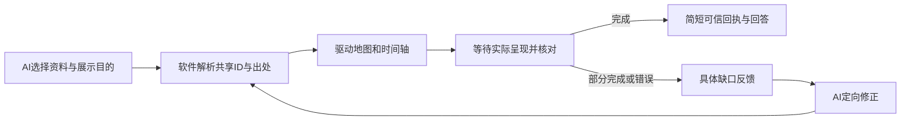

# AI 与组件协作：问题在哪，下一步改什么

结论：这几次问题并非都来自格式。**主要缺口是 AI 与软件之间的责任划分、以及操作后的完成核对**，其中也有具体实现错误。共享资料底层和地图、时间轴可以继续使用，不必整套推倒。

## 用这次真实赤壁试用说明

| 现场 | 原因 | 状态 |
| --- | --- | --- |
| 工具读到了七阶段，收尾却合并或改写阶段 | 收尾保留原文和操作回执，却丢掉已返回的阶段字段 | 本批已修，真实回答保留七个已有阶段 |
| 选择事件的参数被忽略，仍回成功 | 工具参数混用，输入与实际动作不一致 | 上批已修，错误参数明确拒绝 |
| AI 把完整火攻阶段筛成一个起点 | 参数合法，但“设置这个时间点”不等于“显示整个阶段” | 尚需改协作接口 |
| 操作成功后，AI 没有拿到新的画面状态 | 操作回执与实际呈现的完成核对脱节 | 尚需闭合反馈 |
| 为找七阶段翻了四页事件目录 | 查询面向全部事件，未直接沿已有父子关联取资料 | 下一批减少准备往返 |

本次模型实际设置原文顺序 **612—612**。在相同真实数据上点击软件的火攻阶段按钮，范围是 **612—613**，并出现已有的火攻行动路线。两种参数都合法，所以只做 JSON 格式检查找不到这个问题。数字是内部原文顺序，不是历史日期。

## 让 AI 决定目的，让软件完成确定的计算

AI 仍决定用什么组件、展示哪些资料、怎样组织布局。软件负责已知 ID 的查找、出处定位、完整范围计算、组件操作和结果核验。例如 AI 提出“在这张图展示这个已有阶段”，就不必再手算页序、时轴坐标、路线筛选和相机位置。

这增加的是一层通用协作能力，不是固定赤壁模板。已有的细粒度工具仍可供自由调整；没有日期就保留原文顺序，没有有据路线就说明缺少依据，不强迫生成。

## 反馈应包含什么

一次操作应返回“请求达到什么、实际做到什么、还缺什么”，区分已接受、已应用、已观察。筛选生效后，再取得同一书籍、范围和视图版本下的实际投影；不能仅因状态变量赋值成功就说画面已核对。

- 格式或 ID 错误：给准确字段、错误值、本范围可用候选；只修改错误部分。
- 呈现未就绪：软件本地等待或返回未就绪，不让 AI 重复发收费请求来等画面。
- 目标仅部分完成：返回期望与实际范围、事件和路线，以及未满足的原因。
- 缺少资料或无法确定：保留已完成内容和不确定性，不靠编造补齐，也不把所有未知都当错误重试。

自动修正要共用原任务预算，先允许有限的一到两轮；同一错误反复出现就保存现场，明确留下待处理项。涉及修改已有事实仍沿用审阅与撤销，不因“修格式”绕开用户修改或扩大读取范围。请求详情里保留这组目标、实际回执与 AI 公开修正，方便人检查。

## 下一批的具体落点

1. 从已有父事件直接读取七阶段及实际出处，减少扫描全部事件；继续使用同一套共享数据。
2. 提供按已有事件/阶段身份展示的操作，软件推导完整范围并返回实际呈现回执；具体接口名以实现评审为准，本文不是已实现的 API。
3. 接入上述有限反馈修正；先复用本次失败参数做离线回放，再少量真实调用。

验收仍用这份冻结赤壁资料：不新建重复知识或视图；完整火攻范围、已有路线、实际画面回执与最终回答一致。正确性和真实请求成本一起比较，不能仅凭格式通过或合成检查宣布达到理想效果。

证据：`logs/chibi-closeout-knowledge-20261110/failure-cases/partial-phase-filter.json`；模型实际画面与人工完整阶段对照分别在 `real1/ui-model-result/` 和 `real1/ui-manual-complete-phase/`。原始输入、公开返回和失败状态均已在退出前保存。
